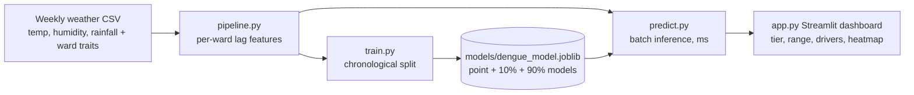

# Architecture: Dengue Early-Warning System

Predicts, for each of 60 wards (Dhaka North/South, Chattogram, Gazipur, Narayanganj), the dengue risk tier
(**Low / Medium / High / Critical**) for the window **2 to 4 weeks after** the latest weather observation.

## 1. Data flow



```
raw weekly rows --> group by ward_id --> rainfall lags 0-8w, rolling sums, temp/humidity lags, season
                --> target = mean cases in weeks t+2..t+4  --> HistGradientBoosting (+quantile models)
                --> joblib file --> dashboard loads once (cached) --> tier + 80% range + driver breakdown
```

## 2. Feature pipeline (`src/pipeline.py`)
* Rows are sorted and **grouped by `ward_id`** before every shift/rolling call, so a lag never leaks from one ward into another.
* Rainfall lags 0-8 weeks, rolling sums over 2/4/8 weeks and an explicit **2-4 week "breeding window" sum** (lags 2+3+4). This encodes the
  vector breeding clock (eggs to adult mosquito 7-14 days, then incubation and symptoms).
* Temperature and humidity: current, lags 1/2/4 weeks, 4-week mean. Season as sin/cos of week of year.
* Static ward vulnerability: `population_density_sqkm`, `water_logging_risk_index`, `sanitation_score`.
* Target: mean weekly cases over weeks t+2 to t+4 (the 2-4 week early-warning window).
* Only weather and ward traits are model inputs. **Past case counts are deliberately not used**, so the system works where case reporting is delayed,
  which is exactly when early warning matters.

## 3. Chronological validation split (no leakage)
| Set | Period | Use |
|---|---|---|
| Train | 2016-01 to 2022-12 | fit, derive risk-tier thresholds |
| Validation | 2023 | check generalisation before the final fit |
| Test | 2024-01 to 2025-12 | never seen in training, reported below |

No random shuffling: random splits would let next-week rows of the same outbreak sit in training and inflate scores.
The final model is fitted on 2016-2023 and evaluated once on 2024-2025.

**Risk tiers** use thresholds from the *training* target only (60th / 85th / 97th percentile of weekly cases, about 1.0 / 7.3 / 13.7 cases per week),
so Low = quiet, Critical = top ~3% historical intensity.

## 4. Model selection rationale
* **HistGradientBoostingRegressor** (scikit-learn): the outbreak response is non-linear (rain has a delayed, thresholded effect, interacting with
  drainage and sanitation). Trees capture this without manual feature crosses; it trains in about 3 seconds on CPU, and predicts all 60 wards in milliseconds.
* Two extra quantile models (10% and 90%) give an **80% forecast range**.
* A deep model was rejected: only ~31k rows, and the explanation of drivers matters to health officers.

### Results on the held-out 2024-2025 test set
| Model | MAE (cases/week) | RMSE |
|---|---|---|
| **Gradient boosting (ours)** | **0.83** | **1.58** |
| Ward x week-of-year historical mean | 0.91 | 1.70 |
| Ward mean | 2.95 | 3.47 |

Tier accuracy 83%, within one tier 99.9%. The 80% range covers 92% of outcomes (conservative). Honest limitation: recall on the rarest
"Critical" tier is only about 34%, i.e. the model often labels true Critical weeks as High. The seasonal baseline is strong because dengue here is
highly seasonal, so the gain over it is modest (about 9% lower MAE). Full numbers: `models/metrics.json`.

## 5. Compute and API cost controls
* **Zero external API / LLM calls.** The whole system is classical ML running locally, so API cost and token cost are 0 by design.
* Model is **serialized with joblib** (`models/dengue_model.joblib`, compressed); training is a separate step (`python src/train.py`), inference only loads the file.
* Dashboard uses `st.cache_resource` (model loaded once per process) and `st.cache_data` (features and predictions for all wards computed once per dataset);
  changing city, ward or week does not recompute anything.
* Vectorised batch prediction for all wards in one call; driver explanation costs about 20 ms per ward.
* If an LLM summary is added later (Final Sprint), it should be called once per ward-week with a short templated prompt and cached by (ward, date).

## 6. Driver explanation
For the selected ward-week, each factor group (rainfall, temperature, humidity, season, ward vulnerability) is reset to its training median and the
change in forecast is shown. Red bars push risk up, green down.

## 7. Production path (for the Onsite Final)
Swap the CSV for a weather feed, retrain on a schedule, keep `build_features` unchanged (it already accepts a new CSV without `dengue_cases` via the dashboard upload).

---

# Phase 2 (onsite final): operations layer

Phase 2 extends the same repository and the same saved model. Forecasts feed an operations layer that turns predicted
cases into supplies, beds, spraying crews and dispatch notices. Everything runs locally: no network, no LLM.

## Data flow

```
weekly weather + ward traits --> Phase 1 features --> saved HistGradientBoosting model --> predicted cases + risk tier
        |                                                                                          |
        |                       +---------------- src/ops.py ------------------------------------+--+
        |                       |  1 allocate(): supplies under scarcity, priority order          |
        |                       |  2 route_overflow(): same-city bed transfers                     |
        |                       |  3 plan_crews()/simulate(): model re-run with crews deployed     |
        |                       +-----------------------------------------------------------------+
        +--> src/dispatch.py: SMS (en/bn), WhatsApp (en/bn), printable HTML brief --> /exports
```

Files: `src/ops.py` (math), `src/dispatch.py` (templates), `src/export.py` (CLI + orchestration),
`src/offline_check.py` (kill-switch test), `ops_ui.py` (dashboard tabs), `app.py`.

## 1. Constrained resource allocation
Demand per ward = ceil(predicted weekly cases x supply-per-case ratio). The ratios (saline 2.38, kits 1.15, beds 0.29 per case)
are fitted from the onsite dataset (sum of supply columns / sum of cases), so they match how the dataset defines need.
Regional stock = slider (30% to 100%) x total demand. Wards are served in strict priority order: risk tier first
(Critical > High > Medium > Low), then expected cases x population density (relative to the median ward). Each ward receives
min(need, stock left). Any ward that cannot be fully served is flagged "Deficit", and "CRITICAL DEFICIT" if it is High or Critical.
Spraying crews follow the same order (Critical/High: enough crews to cover the ward's density, Medium: 1, Low: 0).
Why strict priority and not proportional sharing: with scarce saline, spreading it thinly leaves every outbreak ward under-supplied.

## 2. Hospital surge and overflow routing
The dataset has no bed capacity. Default capacity is a stated planning assumption: each ward's 95th-percentile weekly bed need in the
training years x a fixed facility-size multiplier (0.5 to 1.7, seeded by ward id so results are reproducible) x the officer's slider.
A real bed census can be uploaded as CSV (ward_id, bed_capacity) and replaces the assumption. Wards over capacity send patients
only to wards in the same city, most free beds first. Output: net deficit and headroom per ward, transfers, city-wide utilisation,
and patients that cannot be placed anywhere in the city.

## 3. What-if vector control simulator
Counterfactual, not a fixed percentage: crews reduce the rain-driven breeding signal fed to the saved model (all `rain_*` features
x (1 - 0.60 x coverage)), and the model is re-run. Coverage = crews / crews needed for the ward's density (1 to 3 crews).
The effect builds up over the forecast window: 60% in week 2, 85% in week 3, 100% in week 4. Beds and saline saved are
cases prevented x the same supply ratios. ROI = cases prevented per crew. The best deployment adds crews one at a time
where the marginal cases prevented is highest (diminishing returns, so crews spread across wards). Assumptions
(60% maximum cut, ramp, density per crew) are stated constants in `src/ops.py`; they are planning assumptions, not measured effects.

## 4. Dispatch notices
Deterministic templates fill predicted cases (with 80% range), allocated vs required supplies, deficit alerts, overflow transfers
and assigned crews. SMS is kept near 160 characters (English), WhatsApp is multi-line, and the commissioner brief is a
self-contained HTML page (Print to PDF). English and Bangla. `python src/export.py` writes samples to `/exports`.

## 5. Offline resilience
Nothing in the forecast, allocation, routing, simulator or notices calls a network. The model is a local joblib file, fonts are system
fonts, and no API keys exist. `python src/offline_check.py` (also a button in the dashboard sidebar) blocks all socket connections and runs
the entire pipeline; it passes in about 2 seconds.

## Limitations (honest)
Bed capacity and intervention efficacy are assumptions (stated above) because the data has neither. The simulator predicts the effect
of fewer breeding sites through the model's rainfall dependence; it is a planning tool, not a causal estimate. Critical-tier recall
from Phase 1 (about 34%) still applies, so High and Critical are treated together for alerts.
