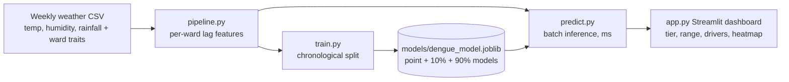

# Architecture: Dengue Early-Warning System

Predicts, for each of 60 wards (Dhaka North/South, Chattogram, Gazipur, Narayanganj), the dengue risk tier
(**Low / Medium / High / Critical**) for the window **2 to 4 weeks after** the latest weather observation.

## 1. Data flow



```
raw weekly rows --> group by ward_id --> rainfall lags 0-8w, rolling sums, temp/humidity lags, season
                --> target = mean cases in weeks t+2..t+4  --> HistGradientBoosting (+quantile models)
                --> joblib file --> dashboard loads once (cached) --> tier + 80% range + driver breakdown
```

## 2. Feature pipeline (`src/pipeline.py`)
* Rows are sorted and **grouped by `ward_id`** before every shift/rolling call, so a lag never leaks from one ward into another.
* Rainfall lags 0-8 weeks, rolling sums over 2/4/8 weeks and an explicit **2-4 week "breeding window" sum** (lags 2+3+4). This encodes the
  vector breeding clock (eggs to adult mosquito 7-14 days, then incubation and symptoms).
* Temperature and humidity: current, lags 1/2/4 weeks, 4-week mean. Season as sin/cos of week of year.
* Static ward vulnerability: `population_density_sqkm`, `water_logging_risk_index`, `sanitation_score`.
* Target: mean weekly cases over weeks t+2 to t+4 (the 2-4 week early-warning window).
* Only weather and ward traits are model inputs. **Past case counts are deliberately not used**, so the system works where case reporting is delayed,
  which is exactly when early warning matters.

## 3. Chronological validation split (no leakage)
| Set | Period | Use |
|---|---|---|
| Train | 2016-01 to 2022-12 | fit, derive risk-tier thresholds |
| Validation | 2023 | check generalisation before the final fit |
| Test | 2024-01 to 2025-12 | never seen in training, reported below |

No random shuffling: random splits would let next-week rows of the same outbreak sit in training and inflate scores.
The final model is fitted on 2016-2023 and evaluated once on 2024-2025.

**Risk tiers** use thresholds from the *training* target only (60th / 85th / 97th percentile of weekly cases, about 1.0 / 7.3 / 13.7 cases per week),
so Low = quiet, Critical = top ~3% historical intensity.

## 4. Model selection rationale
* **HistGradientBoostingRegressor** (scikit-learn): the outbreak response is non-linear (rain has a delayed, thresholded effect, interacting with
  drainage and sanitation). Trees capture this without manual feature crosses; it trains in about 3 seconds on CPU, and predicts all 60 wards in milliseconds.
* Two extra quantile models (10% and 90%) give an **80% forecast range**.
* A deep model was rejected: only ~31k rows, and the explanation of drivers matters to health officers.

### Results on the held-out 2024-2025 test set
| Model | MAE (cases/week) | RMSE |
|---|---|---|
| **Gradient boosting (ours)** | **0.83** | **1.58** |
| Ward x week-of-year historical mean | 0.91 | 1.70 |
| Ward mean | 2.95 | 3.47 |

Tier accuracy 83%, within one tier 99.9%. The 80% range covers 92% of outcomes (conservative). Honest limitation: recall on the rarest
"Critical" tier is only about 34%, i.e. the model often labels true Critical weeks as High. The seasonal baseline is strong because dengue here is
highly seasonal, so the gain over it is modest (about 9% lower MAE). Full numbers: `models/metrics.json`.

## 5. Compute and API cost controls
* **Zero external API / LLM calls.** The whole system is classical ML running locally, so API cost and token cost are 0 by design.
* Model is **serialized with joblib** (`models/dengue_model.joblib`, compressed); training is a separate step (`python src/train.py`), inference only loads the file.
* Dashboard uses `st.cache_resource` (model loaded once per process) and `st.cache_data` (features and predictions for all wards computed once per dataset);
  changing city, ward or week does not recompute anything.
* Vectorised batch prediction for all wards in one call; driver explanation costs about 20 ms per ward.
* If an LLM summary is added later (Final Sprint), it should be called once per ward-week with a short templated prompt and cached by (ward, date).

## 6. Driver explanation
For the selected ward-week, each factor group (rainfall, temperature, humidity, season, ward vulnerability) is reset to its training median and the
change in forecast is shown. Red bars push risk up, green down.

## 7. Production path (for the Onsite Final)
Swap the CSV for a weather feed, retrain on a schedule, keep `build_features` unchanged (it already accepts a new CSV without `dengue_cases` via the dashboard upload).
